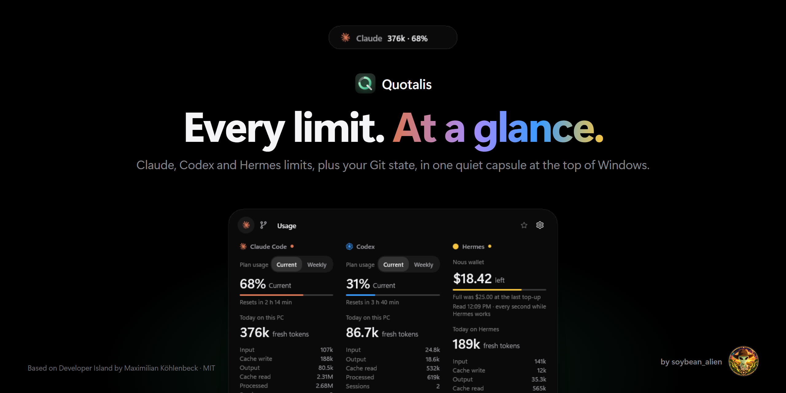
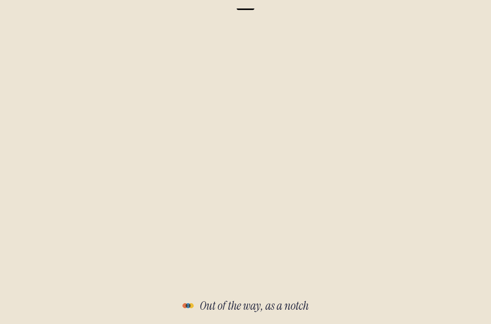
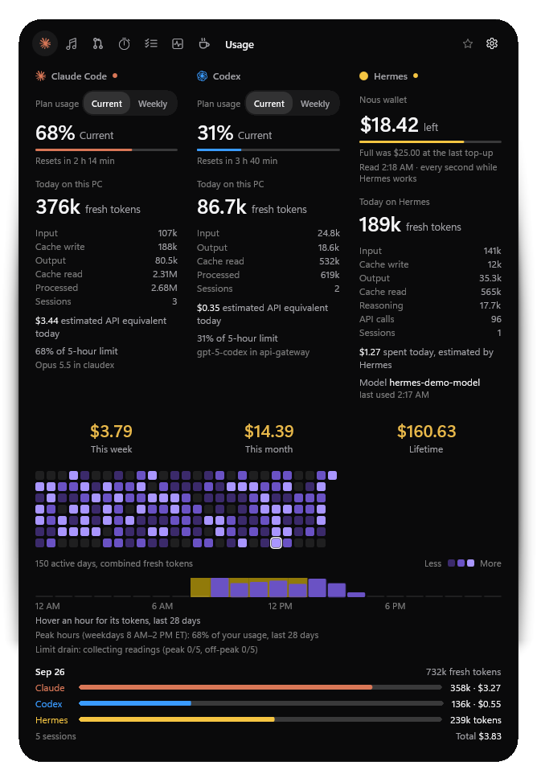
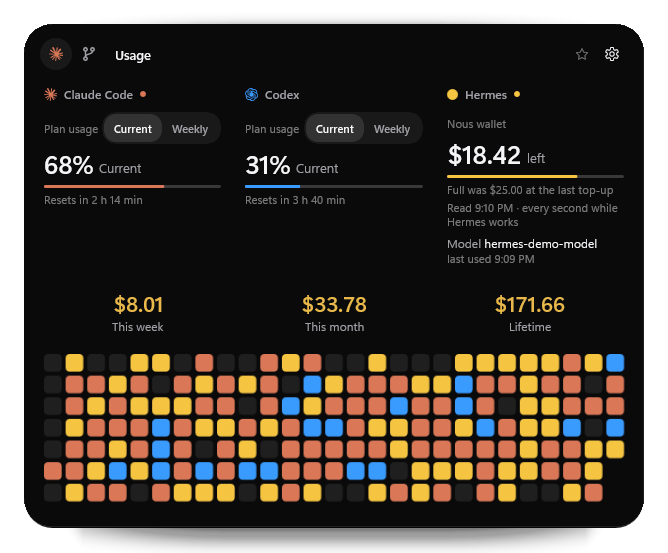
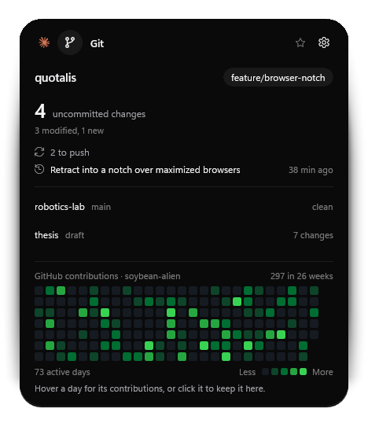
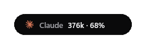
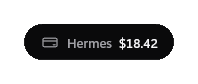
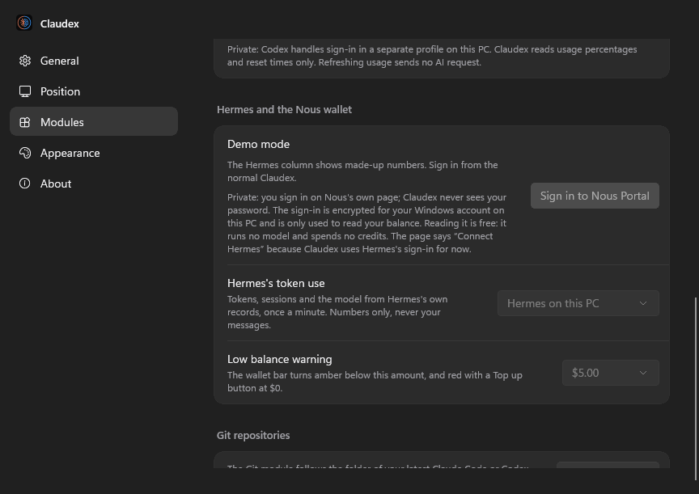
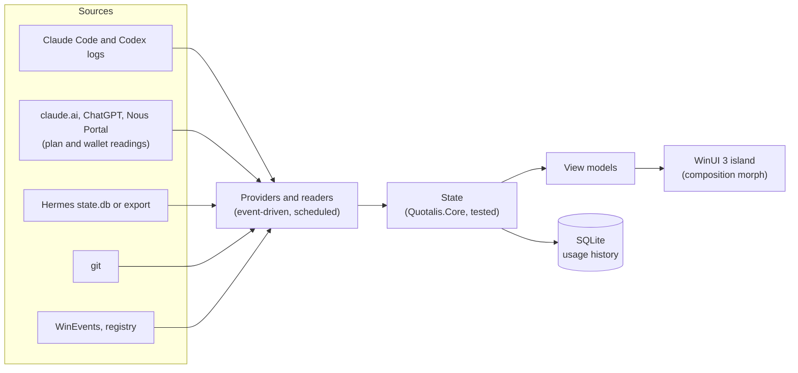

# Quotalis



> A fork of [Developer Island](https://github.com/maximilian467/Developer-Island) by Maximilian Köhlenbeck (MIT), renamed and extended by **soybean_alien**. Upstream is tracked as the `upstream` remote; see [CHANGELOG.md](CHANGELOG.md) for everything Quotalis added.

> **Every AI limit, wallet and token, plus your Git state, in one quiet capsule at the top of your screen.**

Quotalis is a native, floating capsule at the top of your screen. It shows how much of your **Claude**, **Codex** and **Hermes Agent** allowance is left, what each of them used today and where your current repository stands, and opens into a full view when you click it.

[](https://github.com/soybean-alien/Quotalis/actions/workflows/ci.yml)
[](https://github.com/soybean-alien/Quotalis/releases)
[](LICENSE)


<p align="center">
  
</p>

<p align="center"><sub>Demo mode with invented data, rendered by the app itself (<code>--snapshot</code>). In the live app, the states morph with springs.</sub></p>

## Why Quotalis?

AI coding agents spend tokens, plan limits and real credits where you can't see them. Quotalis puts your AI limits and your repository's state into one small capsule that stays out of your way: native, local-first and cheap enough to run all day.

## Features

### AI usage: Claude, Codex and Hermes side by side

- **Claude Code and Codex** from their local logs: today's fresh tokens with the full breakdown (input, cache write, output, cache read, processed), sessions and model.
- **Plan usage, measured, never guessed:**
  - **Claude:** the 5-hour and weekly windows, read from claude.ai after a one-time sign-in in Settings (a few seconds after each reply, every 2 minutes otherwise). Terminal sessions can also hand them over through Claude Code's status line.
  - **Codex:** ChatGPT's shared Work/Codex allowance after signing in with ChatGPT (through the locally installed Codex), with every limit bucket and its reset time in Settings; Codex's own logs are the fallback.
- **Hermes Agent** ([Nous Research](https://github.com/NousResearch/hermes-agent)) in its own yellow column:
  - **The Nous wallet drains instead of filling:** full after a top-up or plan renewal, it empties as Hermes spends, turns amber below a threshold you pick (default $5) and red at $0 with a **Top up Nous wallet** button. Hover the amount for plan credits, purchased credits and the renewal date.
  - Read **every second while Hermes works**, every 5 minutes after 5 quiet minutes, and never while the PC is locked or asleep. Reading the balance is a free account read: it runs no model and spends no credits.
  - **Coming soon:** the wallet waits for Quotalis's own Nous Portal sign-in. Until then Settings shows no sign-in button and the column says "Nous wallet coming soon"; Hermes's token use and model already work.
  - **Today on Hermes:** fresh tokens, input, cache write, output, cache read, reasoning, API calls, sessions and what Hermes spent (marked "estimated by Hermes" unless Nous billed an exact amount), plus the **model** Hermes used last, which can change at any time. From a Hermes install on this PC, or from your server through a small export job ([tools/hermes](tools/hermes)).
- **Running totals in gold:** this week, this month and lifetime, as an **estimated API equivalent** at public list prices for Claude and Codex. Hermes spends real credits, so its money stays in its own column and out of these totals.
- **A 26-week usage graph** of every tool's fresh tokens. Hover a day for each tool's share, click to pin it.
- **Usage by hour** over the last 28 days, with Anthropic's peak hours shaded (adjustable in Settings), your peak-hour share, and how fast Claude's 5-hour limit drains per dollar in and out of peak hours.
- **The usage strip:** with "Always display usage", the island rests as a slim strip with plan usage, the wallet, the gold totals and the graph, and opens in full while you use it.
- The compact capsule reads like `Claude 376k · 68%`, or Hermes's balance when you star Hermes.
- A short **live activity** when a Claude Code session starts, with the project's folder name.

### Git

- **Your current repository:** the one your latest Claude Code or Codex session works in (or any you add): branch, uncommitted changes, commits to push or pull, the last commit, and a few other recent repositories one click away. Local only, through Git for Windows. More Git features are on the way.

### Smart island

- **Compact, live activity and expanded** states with interruptible spring animations. **Keep the island open** if you'd rather it didn't roll back up when you click elsewhere.
- **App-aware auto-hide:** while Chrome, Edge, Firefox or any app you list is in front, the island retracts into a 5 px notch in the screen edge (or hides).
- **Camera and microphone indicators** in every state, as tiny dots in the notch.
- **Anywhere you want it:** six anchors or a free position on any monitor, per-monitor DPI, a global shortcut (Ctrl + Alt + C), tray menu and Start with Windows.
- **Favorites:** star a tab and the compact capsule features it; several favorites take turns.
- **Updates itself:** Settings, About checks this repository's releases on GitHub, no account needed (daily if you like), and installs a new version on your click after checking its SHA-256.

All details per module: [docs/MODULES.md](docs/MODULES.md).

## Preview

| Claude, Codex and Hermes | The usage strip |
|---|---|
|  |  |
| **Git** | |
|  | |
| **Compact capsule** | **Hermes and the Nous wallet, in Settings** |
| <br><br> |  |

<sub>All screenshots show demo data.</sub>

## Privacy

Quotalis is **local-first**. It has no account, no telemetry and no cloud sync, and it does not upload your prompts or code.

- **Read locally:** Claude Code transcripts (`~/.claude/projects`), Codex rollout files (`~/.codex/sessions`) and, for the Hermes column, Hermes's own database (read-only) or its export. Only usage metadata is extracted (token counts, costs, model, timestamps, session ids, working folder); prompt, message and code content is never stored, displayed or logged.
- **Stored locally** in `%LOCALAPPDATA%\Quotalis` and `%USERPROFILE%\.quotalis`: a SQLite database with token counts and daily totals, settings, the last plan percentages and the wallet bar's scale. Logs contain events and error types, never content or amounts, and are kept for 7 days.
- **Sign-ins stay on this PC and Quotalis never sees your passwords:**
  - claude.ai: its cookies stay in a browser profile (`.quotalis\claude-signin`); Quotalis never reads the cookie values.
  - ChatGPT: handled by the locally installed Codex in an isolated profile (`.quotalis\chatgpt-signin`); Quotalis never reads those credentials.
  - Nous Portal (once the wallet ships; public builds have no Nous sign-in yet): Nous's device sign-in (you approve a code on Nous's page). The tokens are encrypted for your Windows account (`.quotalis\nous-signin.bin`), never logged, and used only to read the wallet. Nous lets them run models; Quotalis never does.
  - The updater needs no sign-in; it reads the public releases. The GitHub heatmap in the Git tab goes through the GitHub CLI's own sign-in.
- **Network:** only what you switch on: claude.ai's usage page, Codex's ChatGPT requests, Nous Portal's account read (once the wallet ships), the copy of your server's Hermes export (over SSH with your own key), the update check (GitHub's public releases) and the GitHub heatmap (through the GitHub CLI). None of these readings sends a message to an AI model.
- **Camera and microphone:** only "in use or not" is read from Windows' own consent store; app names are never stored or shown.

Full details: [docs/PRIVACY.md](docs/PRIVACY.md) and [SECURITY.md](SECURITY.md).

## Installation

1. Download `Quotalis-Setup-<version>.exe` from the [latest release](https://github.com/soybean-alien/Quotalis/releases/latest).
2. Run it. It installs per user into `%LOCALAPPDATA%\Programs`, without administrator rights and without a separate .NET runtime.
3. Launch **Quotalis** from the Start menu. It appears at the top center of your screen.

Later versions install from inside the app (Settings, About, Updates). The installer is not code-signed yet, so Windows SmartScreen may ask you to confirm ("More info", then "Run anyway"). A portable zip is attached to each release as well: extract it completely and run `Quotalis.exe`.

**Requirements:** Windows 11 x64 (tested). Windows 10 version 2004 or later is supported by the build but not yet tested. The Git module needs [Git for Windows](https://git-scm.com/download/win), its GitHub heatmap the [GitHub CLI](https://cli.github.com/), ChatGPT plan usage the Codex app or CLI, and a server's Hermes export Windows' built-in OpenSSH client.

## Quick start

| Do this | And you get |
|---|---|
| Hover the capsule | A peek at the most relevant live information |
| Click it, or press **Ctrl + Alt + C** | The expanded island; Esc or a click elsewhere closes it |
| Click the ☆ next to a module's name | That module is featured in the compact capsule |
| Drag the capsule | Move it; it snaps to the nearest anchor |
| Settings, Modules, **Claude plan usage**, Sign in to claude.ai | Claude's 5-hour and weekly usage, a few seconds after each reply |
| Settings, Modules, **ChatGPT plan usage**, Sign in with ChatGPT | The shared Work/Codex allowance and every limit bucket, with reset times |
| Settings, Modules, **Hermes and the Nous wallet**, turn on Hermes | The Hermes column: Hermes's tokens, its spend and its model (the Nous wallet is coming soon) |
| Settings, General, **Always display usage** | The island rests as the usage strip |
| Settings, Position, **Auto-hide in apps** | Choose which apps make the island step aside |

Want to look around first? Start **Quotalis (Demo)** from the Start menu, or run `Quotalis.exe --demo`. Demo mode uses invented data only: it never reads your usage, wallet or repositories, and its settings are kept separately.

## Configuration

Everything is set in the Settings window and applies immediately:

| Section | Settings |
|---|---|
| General | Start with Windows, always on top, launch hidden, keep the island open, always display usage, keyboard shortcut, Claude peak hours |
| Position | Monitor, anchor, custom position; auto-hide in apps (notch or hide, only when maximized, app list) |
| Modules | Each module on or off and its order; Claude plan usage; ChatGPT plan usage; Hermes and the Nous wallet (token source, low balance warning; the wallet sign-in is coming soon); Git repositories |
| Appearance | System or Dark for Settings (the island itself is always dark) |
| About | Version, updates, daily update check, data folder |

API prices and the exchange rate for the API equivalent can be adjusted in `%USERPROFILE%\.quotalis\pricing.json` ([example](docs/PRIVACY.md)).

## Architecture



Data flows one way. `Quotalis.Core` holds all logic without UI (the island state machine, auto-hide policy, parsers, aggregation, the Nous wallet and its polling rule) and is covered by unit tests; the WinUI app adds views, windowing and Windows integrations. A module that is turned off runs no watchers, timers or processes. Details: [docs/ARCHITECTURE.md](docs/ARCHITECTURE.md), [docs/PERFORMANCE.md](docs/PERFORMANCE.md).

## Tech stack

C# and .NET 10 · WinUI 3 and Windows App SDK 1.8 · WebView2 · SQLite (Microsoft.Data.Sqlite) · xUnit · Inno Setup

## Building from source

Requirements: the [.NET 10 SDK](https://dotnet.microsoft.com/download/dotnet/10.0) and Git; Visual Studio is optional.

```powershell
git clone https://github.com/soybean-alien/Quotalis.git
cd Quotalis
dotnet test tests/Quotalis.Tests     # build and run the tests
.\run.cmd -Demo                     # build and start with demo data (.\run.cmd for your real data)
```

Release build (tests, self-contained publish, portable zip, installer; the installer needs [Inno Setup 6](https://jrsoftware.org/isinfo.php)), then a check that nothing personal is in it:

```powershell
powershell -ExecutionPolicy Bypass -File tools/build-release.ps1
powershell -ExecutionPolicy Bypass -File tools/privacy-scan.ps1 artifacts/publish/win-x64 artifacts/Quotalis-<version>-win-x64-portable.zip
```

More, including offscreen snapshots and the README media: [docs/DEVELOPMENT.md](docs/DEVELOPMENT.md) and [docs/RELEASING.md](docs/RELEASING.md).

## Accessibility

- Fully usable from the keyboard: the global shortcut opens the island with focus, Tab and the arrow keys move through it, Esc closes it and returns focus to where you were.
- Respects the Windows "Animation effects" setting.
- Per-monitor DPI aware: the island can be dragged between monitors with different scaling, and placement is recalculated when scaling or monitors change.
- Controls carry accessible names for screen readers; a full Narrator pass is still open.

## Known limitations

- **Plan usage needs a one-time sign-in** for Claude (claude.ai) and Codex (ChatGPT through the Codex app or CLI); token usage works either way. claude.ai's usage address isn't a public API: if it changes, Quotalis shows "unknown format" instead of a wrong number.
- **Hermes:** the wallet works with Nous Portal only. Nous reports no model per call, so the model shown is the one in Hermes's own records (a minute late at most from a server). The wallet stays locked in public builds until Quotalis has its own Nous Portal app name (today's sign-in would borrow Hermes's).
- The installer is **not code-signed** yet. Only **x64** is built and tested.
- More in [docs/STATUS.md](docs/STATUS.md).

## Roadmap

- A Quotalis app name of its own with Nous Portal
- Code signing and a winget package
- More Git: the next features for the Git tab
- More AI tools through the provider interface
- A layout per display, and ARM64 builds

No dates; priorities follow feedback.

## Credits and AI disclosure
- Made by **soybean_alien**. Licensed under the **MIT License** (see [LICENSE](LICENSE)).
- Based on [Developer Island](https://github.com/maximilian467/Developer-Island) by Maximilian Köhlenbeck (MIT). Third-party components keep their own licenses: [THIRD_PARTY_NOTICES.md](THIRD_PARTY_NOTICES.md).
- Built on [.NET 10](https://github.com/dotnet/runtime) and [WinUI 3 / Windows App SDK](https://github.com/microsoft/WindowsAppSDK).
- Claude is a trademark of Anthropic, Codex and ChatGPT of OpenAI, and Hermes Agent and Nous Portal belong to Nous Research. Quotalis is an unofficial project and isn't affiliated with or endorsed by any of them. Claude Code and Codex are shown with the Claude and OpenAI marks (from Simple Icons, CC0).
- **AI disclosure:** Quotalis was designed with and written by **Claude Code (Anthropic, Claude Opus 5.5)**, with some releases by **Codex (OpenAI)**, directed and tested in the real app by the author on Windows 11.

The design follows an [Apple design analysis](docs/design/apple-design-analysis.md), the [Taste Skill](https://github.com/Leonxlnx/taste-skill) and the [Vercel Web Interface Guidelines](https://github.com/vercel-labs/web-interface-guidelines).
