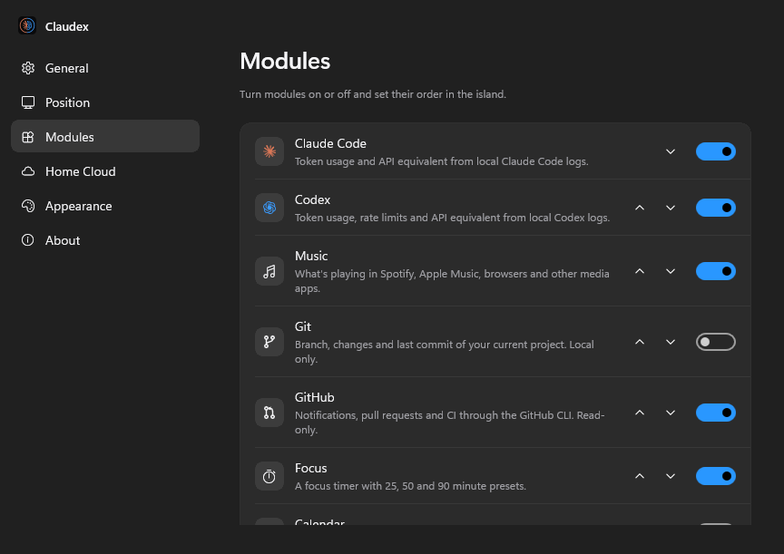
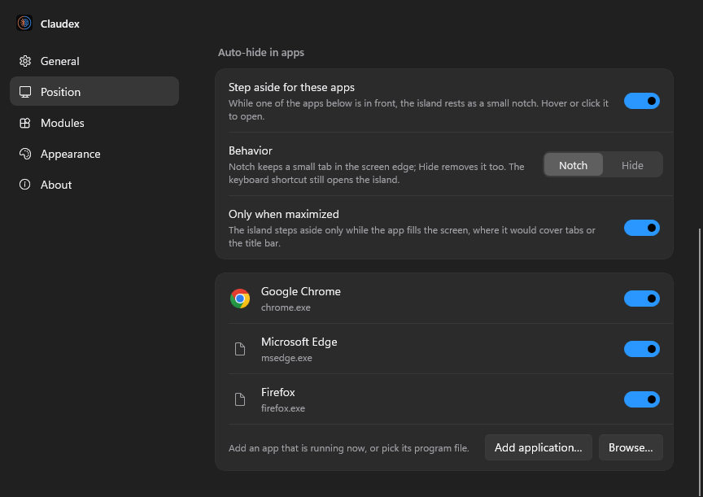

# Modules

What each module shows, where its data comes from and how it behaves. The [README](../README.md) has the overview; [ARCHITECTURE.md](ARCHITECTURE.md) explains how the modules are built.

## The island

- **Three states.**
  - The **compact** capsule shows what matters right now.
  - A **live activity** (medium state) appears for AI events (a Claude Code session starting), or while you hover.
  - The **expanded** island opens on click.
- **Spring motion from the anchor.** The capsule morphs on the GPU compositor and grows away from the edge it rests on. Every animation can be interrupted and respects Windows "Animation effects".
- **Your module, in the capsule.** Star any tab in the expanded island (the star sits next to Settings, in the same place on every tab; on Usage it stands for the enabled AI tools) and the compact island features it: "Claude 376k · 68%", the Hermes wallet ("$18.42"), or the repository and its changes. Several favorites take turns every 7 seconds; without favorites the module you opened last is shown, and hovering or opening the island shows that module too (never a fixed default). Ticking values keep their width ("376k" and "1.12M" take the same room), so the capsule does not jitter; long text ends in an ellipsis.
- **Camera and microphone.** While any app uses the microphone or the camera, a small orange microphone or green camera mark appears in the compact capsule, the live activity and the expanded island; in the notch it is only a tiny orange or green dot, and the notch keeps its size. It is a global signal, not a module, and never opens the island.
- **Hover that behaves.** A peek opens after a short, deliberate hover (about 280 ms). Hover is judged against the visible capsule, so it never sticks. A capsule that just grew under a resting mouse does not take your next click, and any click outside the expanded island closes it.
- **Auto-hide in apps.** A top-center island covers tabs and title bars. While an app you list is in front (Chrome, Edge and Firefox by default, or any app you add), the island retracts into a small notch in the screen edge (48 × 5 px). Hover it for 450 ms or click it to open. Choose per app, hide completely instead, or retract only while the app is maximized. This works the same whatever the island shows (Claude, Codex, Hermes, Git, or the open island). It reacts at once, also when you switch apps quickly: the app that is in front last always decides, and module updates (usage, wallet, Git) never bring the island back out. While a camera or microphone is in use, "hide completely" keeps the notch instead (same size) so its dot stays visible.
- **Anywhere you want it.** It sits at Top Center by default. There are five more anchors, or you can drag it anywhere; near an anchor it snaps into place. Drag it onto another monitor, also one with a different scale; the point you hold stays under the cursor. The monitor, anchor and offset are saved. The monitor is recognized by its hardware id, so the island returns to the right display after docking or reconnecting, and it falls back to the primary monitor while that display is disconnected.
- **Out of the way.** The window region follows the capsule, leaving the rest of the desktop clickable. Hovering or dragging does not activate the island. It steps aside while a fullscreen app is on its own monitor; one on another monitor does not move it.
- **Keyboard.** **Ctrl + Alt + C** opens or closes the island from anywhere; four other combinations are available if another app already uses it. Esc closes the island, and focus returns to where you were. Tab and the arrow keys move through the expanded view.
- **Tray and autostart.** The notification-area menu offers Show, Hide, Settings and Quit. Start with Windows is a native per-user setting, with no scripts.

  
   
  

## The modules

Eleven modules, each of which can be turned off or reordered in Settings (Claude, Codex and Hermes share the Usage tab). The expanded island shows them as icon tabs, in your order, with the selected module's name beside them. A turned-off module does no work at all: no watchers, timers or processes.

Every module has the same four honest states: working; **empty** (nothing to show yet, with what to do about it); **unavailable** (a prerequisite is missing, such as Git for Windows); and **error** (reading failed, with a retry). The rest of the island always keeps working.

### Claude Code and Codex

Quotalis reads usage metadata from Claude Code's local transcripts (`~/.claude/projects`, or `CLAUDE_CONFIG_DIR`) and Codex rollout files (`~/.codex/sessions`, or `CODEX_HOME`).

Tokens are counted the way the providers bill them:

| Metric | Meaning |
|---|---|
| **Input** | New, uncached input |
| **Cache write** | Input written to the prompt cache |
| **Output** | Generated tokens |
| **Cache read** | Context re-read from the cache on every turn |
| **Fresh** | Input + cache write + output: the work of the day |
| **Processed** | Fresh + cache read: everything the model processed |

Each provider shows its **plan usage** first, when it is known:

- **Claude:** the current (5-hour) and weekly (7-day) windows with their reset times, read from claude.ai the way its own Usage page reads them. Sign in once in Settings, Modules, "Claude plan usage", on claude.ai's own page in a small window. Quotalis then reads a few seconds after Claude Code writes a reply (at most every 15 seconds while it keeps writing) and every 2 minutes otherwise, backing off when claude.ai can't be reached. These requests send no messages, so they never count against your limits. Your sign-in stays on this PC; Quotalis keeps only the two percentages and reset times. An expired sign-in or an answer in an unknown format shows no percentage and says why, never a guessed number.
- **Claude Code terminal sessions (optional):** Connect the terminal status line in the same card and Claude Code also hands over the two windows after every reply in a terminal session. Quotalis shows nothing in the terminal and leaves an existing status line of yours alone. The Claude Stop hook of versions before 0.5.14, which had Claude read its usage card and cost model calls, is gone; the installer removes its entries.
- **ChatGPT / Codex:** sign in once from Settings, Modules, "ChatGPT plan usage" using the locally installed Codex app or CLI. Quotalis asks Codex for its account rate limits every 2 minutes and after Codex activity. The card lists the shared Work/Codex allowance and every additional limit bucket the account service returns, with five-hour and weekly reset times where supplied. Codex keeps credentials in a separate local profile; usage reads send no AI requests. The Codex module uses this shared allowance when connected and its own rollout records otherwise. An optional Codex Stop hook, `Quotalis.exe --quotalis-codex-stop-hook` in `~/.codex/hooks.json`, has Codex end replies in sessions over 2 minutes old with that session's exact numbers, such as `🔵 Usage: Codex 5h 18% · wk 41%`.
- A **Current / Weekly** switch picks the window. Without data the block says "Unavailable" and why. Percentages are never computed from token counts.

Below it, **Today on this PC** keeps the full local breakdown. The compact island shows today's **fresh** tokens and the plan percentage when known ("Claude 1.12M · 72%", or "Claude 1.12M tokens"); the estimated API equivalent appears only in the expanded view. The expanded view shows the full breakdown, and a tooltip on the figure lists every exact count. Hovering a day in the usage graph shows its date, fresh tokens per tool on one scale (Claude, Codex and Hermes), sessions and API equivalent below the graph; a click pins that day until the island closes.

Above the graph, **gold totals** add up the estimated API equivalent of Claude and Codex for this week, this month and every stored day. Below it, **usage by hour** (the last 28 days) shades Anthropic's peak hours (weekdays, US Eastern time, adjustable in Settings, General), shows your share of usage in them, and compares how fast Claude's 5-hour limit drains per dollar in and out of peak hours once enough plan readings are collected. **Always display usage** (Settings, General) keeps the island as a slim usage strip: plan usage, the Hermes wallet, the gold totals and the graph.

  

 Cache reads repeat the whole conversation context on every turn, so in long agent sessions they are often 80–90 % of processed tokens; counting them as "usage" made earlier numbers look inflated. The usage graph is shaded by fresh tokens too.

The **estimated API equivalent today** in US dollars prices every category at public list prices, including cache writes (1.25× or 2× input) and cache reads (0.1× input unless listed). If you use a subscription, it is not what you pay. Models without a known list price are reported as "partly priced" instead of being guessed. Codex also shows its latest primary rate-limit usage (usually a 5-hour window), with a live activity at 50, 75 and 90 %.

### Hermes

[Hermes Agent](https://github.com/NousResearch/hermes-agent) (Nous Research) gets a third, yellow column in the Usage tab, which widens when Hermes is on. Hermes runs on credits in a Nous Portal wallet rather than a subscription window, so its column turns the plan bar around:

- **The Nous wallet.** Sign in once in Settings, Modules, "Hermes and the Nous wallet": Quotalis shows a code and opens Nous's own page, where you approve it (it says "Connect Hermes", because Quotalis borrows Hermes's sign-in for now). The bar is full after a top-up or a plan renewal and drains as Hermes spends; it turns amber below your threshold (default $5) and red at $0, with **Top up Nous wallet**. Hovering the amount shows plan credits, purchased credits and the renewal date.
- **Coming soon:** the wallet waits for Quotalis's own Nous Portal sign-in. Until then Settings shows no sign-in button and the column says "Nous wallet coming soon"; Hermes's token use and model already work.
- **When it reads:** every second while Hermes works (the balance moved or Hermes was active in the last five minutes), every five minutes otherwise, and never while the PC is locked or asleep. Throttling and Nous's firewall challenges back off by themselves. The read is `GET /api/oauth/account`, which runs no model and costs nothing. The sign-in is encrypted for your Windows account; Nous's tokens could run models, and Quotalis never uses them for that.
- **Today on Hermes**, from Hermes's own records once a minute: fresh tokens, input, cache write, output, cache read, reasoning, API calls, sessions, and what Hermes spent (its own estimate unless Nous billed an exact amount). The source is a Hermes install on this PC (`%LOCALAPPDATA%\hermes\state.db`, read-only) or a server: the export job in [tools/hermes](../tools/hermes) writes a metadata-only JSON every minute, which Quotalis copies with Windows' OpenSSH and your own key.
- **The model** Hermes used last (it can switch models at any time), from those records.
- Hermes's tokens join the usage graph. Its money is real spending, so it never joins the gold API-equivalent totals.

  

### Git

  

The repository of your latest Claude Code or Codex session, plus any you add in Settings: branch, uncommitted changes (staged, modified, new), commits to push or pull, and the last commit. Up to three other recent repositories are one click away. Quotalis never searches your disk: it only walks up from a session's folder to find its repository. Git runs only when you open the panel or when you commit, check out or fetch.

## Settings

  
  

| Section | Settings |
|---|---|
| General | Start with Windows, always on top, launch hidden, keep the island open, always display usage, keyboard shortcut, Claude peak hours; Quit Quotalis (ends the app, its tray icon and all background work) |
| Position | Monitor, anchor, custom position; Auto-hide in apps (on or off, notch or hide, only when maximized, an app list with icons and Add application or Browse) |
| Modules | Every module on or off and in which order; Claude plan usage; ChatGPT plan usage; Hermes and the Nous wallet; Git repositories |
| Appearance | System or Dark (the island itself is always dark) |

Changes apply immediately.

## Using it

| Action | Result |
|---|---|
| Hover the capsule | A peek at the most relevant live information |
| Click | Opens the expanded island |
| Ctrl + Alt + C | Opens or closes the island from anywhere |
| Esc, or click elsewhere | Closes the expanded island |
| Drag | Moves the island; it snaps to the nearest anchor when close |
| Tray icon | Opens the island with keyboard focus; right-click for the menu |
| `--settings=modules` | On a fresh launch, opens Settings at a section (`general`, `position`, `modules`, `appearance`, `about`) |
